# Brouillon — Rapport Tâche 2

## Informations générales

### Environnement
- Java 17
- Maven Wrapper
- ChatUniTest 2.1.1
- Ollama
- CodeQwen 7B

## Sélection des classes à étudier

### Module sélectionné

Dans le cadre de cette tâche, nous avons choisi de travailler sur le module `tika-core` du projet Apache Tika.
Avant de sélectionner les classes à analyser, nous avons vérifié que le module pouvait être compilé et que ses tests existants pouvaient être exécutés correctement.
La commande suivante a été utilisée depuis la racine du projet :

```bash
./mvnw -pl tika-core -am test
 ```

L'option `-am (also make)` permet également de construire les modules dont tika-core dépend. Cette option était nécessaire puisque l'exécution de tika-core seul ne permettait pas de résoudre la dépendance locale `tika-annotation-processor`.
Le build s'est terminé avec `BUILD SUCCESS`.

### Analyse de la couverture existante

L'énoncé demande de sélectionner entre une et trois classes possédant déjà des tests, mais dont le code n'est pas couvert à 100 %. Nous avons donc commencé par analyser la couverture des tests existants avant d'ajouter de nouveaux tests.
Nous avons utilisé JaCoCo avec la commande :
`./mvnw -pl tika-core -am test jacoco:report`

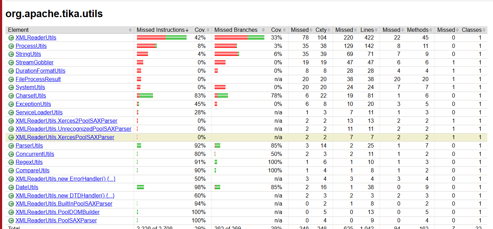

Pour l'ensemble du module tika-core, le rapport initial indiquait notamment une couverture de 46 % des instructions et de 48 % des branches.
Nous avons ensuite examiné les différents packages et nous nous sommes intéressées au package :
`org.apache.tika.utils`

Celui-ci présentait plusieurs classes avec une couverture inférieure à 100 %, ce qui en faisait un bon point de départ pour rechercher des classes candidates.
Vérification de l'existence de tests
Une couverture inférieure à 100 % n'était pas suffisante pour sélectionner une classe. Nous devions également nous assurer que les classes possédaient déjà des tests.
Nous avons donc recherché les fichiers de test présents dans :
 `tika-core/src/test/java/org/apache/tika/utils`

Les fichiers suivants ont notamment été trouvés :

- `CharsetUtilsTest.java`
- `ConcurrentUtilsTest.java`
- ` RegexUtilsTest.java`
- `ServiceLoaderUtilsTest.java`
- `XMLReaderUtilsTest.java`
Nous avons ensuite croisé ces résultats avec ceux du rapport JaCoCo.

|**Classe**|**Test dédié existant** |**Couverture des instructions**|**Couverture des branches**|
|----------|------------------------|-------------------------------|---------------------------|
|CharsetUtils|Oui|83%|78%|
|ConcurrentUtils|Oui|80%|50%|
|RegexUtils|Oui|91%|100%|
|ServiceLoaderUtils|Oui|100%|100%|
|XMLReaderUtils|Oui|42%|33%|

ServiceLoaderUtils a été écartée puisqu'elle était déjà couverte à 100 % et ne répondait donc pas au critère de sélection.

### Prise en compte de la complexité des classes

Nous avons également pris en compte la taille des classes afin de sélectionner un ensemble suffisamment substantiel pour l'expérimentation, tout en restant raisonnable pour l'analyse détaillée des tests et des mutants.
Nous avons obtenu les tailles suivantes :

|**Classe**|**Nombre de lignes**|
|----------|--------------------|
|CharsetUtils|177|
|ConcurrentUtils|49|
|RegexUtils|57|
|XMLReaderUtils|1201|

XMLReaderUtils présentait une couverture particulièrement faible (42 % des instructions et 33 % des branches), mais comptait environ 1201 lignes. Sa taille était très supérieure à celle des autres candidates et aurait considérablement augmenté la portée de l'expérimentation, notamment lors de l'analyse des mutants et de l'ajout éventuel de tests manuels.
Nous avons donc préféré sélectionner plusieurs classes de taille raisonnable présentant des profils de couverture différents.

### Classes retenues

Les trois classes finalement retenues sont :


1. **CharsetUtils**
2. **ConcurrentUtils**
3. **RegexUtils**

Ces trois classes possèdent donc toutes des tests existants sans atteindre une couverture complète, tout en présentant des niveaux de couverture et des caractéristiques suffisamment différents pour permettre de comparer les résultats de la génération automatique de tests et de l'analyse par mutation.

## CharsetUtils — Molly  (Windows 11)

### Usage IA
En plus de ChatUniTest et de CodeQwen exigés par l'énoncé, j'ai été supportée par des outils d'intelligence artificielle , pour m'aider à comprendre les oracles de test, l’analyse des mutants avec PIT et les résultats de couverture. L’IA m’a également aidée à résoudre des problèmes techniques, à concevoir des tests manuels ciblés et à reformuler certaines parties du rapport. Les tests proposés ont été exécutés et vérifiés avec JUnit et PIT.

### ChatUniTest

#### Configuration

ChatUniTest a été configuré dans le module `tika-core` afin de générer des tests à l'aide d'un modèle de langage exécuté localement avec Ollama. Le modèle utilisé est `codeqwen:v1.5-chat`.

Avant la génération, la commande `parse` de ChatUniTest a été exécutée afin d'analyser le projet. L'analyse s'est terminée avec succès et a identifié **361 classes et 1617 méthodes**.

#### Méthodes étudiées

`CharsetUtils` expose trois méthodes publiques principales :

- `isSupported(String charsetName)` : vérifie si un nom de charset est supporté ;
- `clean(String charsetName)` : nettoie et normalise un nom de charset et retourne `null` lorsqu'il n'est pas valide ;
- `forName(String name)` : recherche et retourne le `Charset` correspondant à un nom, en prenant notamment en charge certaines variantes ou erreurs courantes dans les noms de charset.

La génération de tests avec ChatUniTest est effectuée séparément sur ces trois méthodes afin de pouvoir observer et documenter précisément les tests produits, leur capacité à compiler et s'exécuter sans intervention, ainsi que la qualité des oracles générés.

Les méthodes sont étudiées dans l'ordre suivant :

1. `isSupported`
2. `clean`
3. `forName`

#### 1. Génération pour `isSupported`

ChatUniTest a généré un test contenant notamment les trois vérifications suivantes :

```java
assertTrue(CharsetUtils.isSupported("UTF-8"));
assertFalse(CharsetUtils.isSupported("invalid-charset"));
assertFalse(CharsetUtils.isSupported(null));
```

Ces trois cas de test couvrent respectivement :

- un nom de charset valide ( `UTF-8` ) ;
- un nom de charset invalide
- une valeur `null`

Cependant, le test produit par ChatUniTest n'a pas pu être compilé et exécuté directement sans intervention manuelle.

#### Problèmes rencontrés

Le test généré contenait des imports Mockito , notamment :
```java
import org.mockito.*;
import static org.mockito.Mockito.*;
import org.mockito.junit.jupiter.MockitoExtension;
```
Mockito n'est pas une dépendance du module tika-core et ces imports n'étaient pas utilisés par le test. Ils provoquaient donc des erreurs de compilation.
Le test généré contenait également du code utilisant la réflexion sur des éléments internes de CharsetUtils, notamment getCharsetICU. Cette partie reposait sur une interprétation incorrecte de l'implémentation de la classe et produisait notamment un oracle de la forme :

`assertTrue((Boolean) getCharsetICU.invoke(null, "UTF-8"));`

Cette vérification n'était pas valide et dépendait inutilement de détails internes de l'implémentation plutôt que du comportement public de `CharsetUtils`.
ChatUniTest a tenté de corriger automatiquement le test au cours des rounds suivants. Cependant, plusieurs tentatives ont échoué avec une `SocketTimeoutException: Read timed out` . Un appel direct au modèle `codeqwen:v1.5-chat` avec Ollama répondait correctement, ce qui indique que le modèle local était fonctionnel malgré les délais d'attente rencontrés lors des tentatives de correction de ChatUniTest.

#### Corrections manuelles 
Deux catégories principales de corrections fonctionnelles ont été nécessaires pour rendre ce premier test exploitable :
1. suppression des imports Mockito inutiles et indisponibles dans `tika-core` ;
2. suppression des vérifications incorrectes basées sur la réflexion et sur `getCharsetICU`.
Les trois assertions portant directement sur la méthode publique `CharsetUtils.isSupported` ont été conservées.

Le test corrigé a été ajouté dans :

`tika-core/src/test/java/org/apache/tika/utils/CharsetUtilsChatUniTest.java`

Des adaptations de format ont également été nécessaires pour respecter les règles du projet Apache Tika (en-tête de licence Apache, fins de lignes LF et saut de ligne final). Ces adaptations sont considérées séparément des corrections fonctionnelles du test généré.

#### Validation du test corrigé

Le test corrigé à été exécuté avec Maven :
`../mvnw.cmd "-Dtest=CharsetUtilsChatUniTest" test`

Le résultat obtenu est:
`Tests run: 1, Failures: 0, Errors: 0, Skipped: 0  BUILD SUCCESS`

Le test généré pour `isSupported` nécessite donc une intervention manuelle avant de pouvoir être intégré au projet, mais les cas de test pertinents proposés par le modèle ont pu être conservés et exécutés avec succès après correction.

#### 2. Génération pour `clean`

ChatUniTest a ensuite été exécuté sur la méthode `clean`. Plusieurs tests ont été générés, mais aucun n'a compilé directement. Les deux premières générations ont échoué pendant les cinq rounds de correction automatique. Lors de la troisième génération, les rounds 0 à 3 ont également échoué à la compilation et le round 4 s'est terminé par une `SocketTimeoutException`.

L'analyse du test généré au round 0 montre que ChatUniTest proposait trois cas :

```java
assertEquals("UTF-8", CharsetUtils.clean("UTF-8"));
assertEquals(null, CharsetUtils.clean("invalid"));
assertEquals(null, CharsetUtils.clean(null));
```

Ces trois oracles sont cohérents avec l'implémentation de `clean` : un charset valide est normalisé, tandis qu'une entrée invalide ou `null` conduit à une `IllegalArgumentException` interceptée par `clean` , qui retourne alors `null`.

L'échec de compilation provenait des imports Mockito ajoutés automatiquement par ChatUniTest :

```package org.mockito does not exist
package org.mockito.junit.jupiter does not exist
```
Mockito n'est pas utilisé par les tests générés et n'est pas une dépendance de tika-core. Malgré plusieurs rounds de correction, ChatUniTest n'a pas supprimé ces imports automatiquement.

**Correction manuelle effectuée** : suppression des imports Mockito inutiles. Les cas de test et leurs oracles ont été conservés sans modification logique.

Après intégration dans  `CharsetUtilsChatUniTest.java` , les tests ont été exécutés avec Maven :

`Tests run: 4, Failures: 0, Errors: 0, Skipped: 0 BUILD SUCCESS`

Ce résultat comprend le test précédent de `isSupported` et les trois tests générés pour `clean`.

#### 3. Génération pour `forName`

ChatUniTest a généré des tests pour la méthode forName(String) en utilisant le modèle local CodeQwen via Ollama.

La génération automatique a rencontré plusieurs échecs de compilation et des erreurs de délai d'attente (SocketTimeoutException). Le test généré a été récupéré dans les fichiers temporaires de ChatUniTest.

**Corrections manuelles:**

1. Suppression des imports Mockito inutiles , responsables d'erreurs de compilation .
2. Correction de l'oracle pour null : la méthode lève `IllegalArgumentException`.
3. Correction de l'oracle pour cp850 : le nom canonique retourné est IBM850 et non cp850.

Les sept cas générés ont été conservés dans une seule méthode JUnit , `testForName()` .
**Validation** : après correction, les cinq méthodes de test de CharsetUtilsChatUniTest ont été exécutées avec Maven : `5 tests, 0 échec, 0 erreur BUILLD SUCCESS` .


### Oracles
Nous avons comparé les oracles générés par ChatUniTest avec ceux des tests originaux de `CharsetUtilsTest.java` , selon trois critères : **pertinence, précision et capacité à détecter des défauts** .

#### 1. Pertinence des oracles 

Les oracles générés sont globalement pertinents, puisqu'ils vérifient des comportements attendus des trois méthodes publiques de CharsetUtils.

Cependant, plusieurs scénarios sont redondants avec les tests originaux :

-  **isSupported()** : les vérifications de UTF-8, d'un charset inexistant et de null sont déjà représentées dans les tests existants.

-  **clean()** : ChatUniTest vérifie principalement un charset valide, un charset invalide et null. Les tests originaux couvrent également les espaces, les guillemets, les alias et les formats inhabituels.

-  **forName()** : ChatUniTest apporte des assertions directes sur cette méthode, qui était auparavant testée indirectement par les appels à `clean()` .

isSupported() : les vérifications de UTF-8, d'un charset inexistant et de null sont déjà représentées dans les tests existants.

clean() : ChatUniTest vérifie principalement un charset valide, un charset invalide et null. Les tests originaux couvrent également les espaces, les guillemets, les alias et les formats inhabituels.

forName() : ChatUniTest apporte des assertions directes sur cette méthode, qui était auparavant testée indirectement par les appels à clean().

Les oracles générés sont donc pertinents, mais apportent relativement peu de nouveaux scénarios.

#### 2. Précision et validité des oracles 

Les oracles originaux sont généralement plus précis : ils vérifient les résultats exacts de la normalisation, notamment la conversion d'alias en noms canoniques.

ChatUniTest a toutefois généré deux oracles incorrects pour `forName()` :

- **Entrée null** : l'IA attendait IllegalCharsetNameException, alors que la méthode lève IllegalArgumentException.

- **Entrée "cp850"** : l'IA attendait "cp850", alors que Charset.name() retourne le nom canonique "IBM850".

Ces deux erreurs montrent qu'un test généré peut sembler logique tout en reposant sur une mauvaise interprétation du comportement du programme.

Les oracles ont donc dû être vérifiés à partir du code source et des résultats d'exécution avant leur intégration.

#### 3. Capacité à détecter des défauts

Les tests originaux possèdent des oracles plus diversifiés, notamment pour les règles de normalisation et les cas limites. Ils sont donc susceptibles de détecter davantage de défauts liés à ces comportements.

Les tests générés se concentrent davantage sur les cas courants et reproduisent plusieurs assertions déjà existantes. Néanmoins, les assertions directes sur forName() pourraient permettre de détecter certains défauts supplémentaires.

Cette contribution ne peut pas être confirmée par la simple réussite des tests : elle devra être évaluée à l'aide des scores de mutation obtenus avec PIT.

**En conclusion** , ChatUniTest produit des oracles majoritairement pertinents, mais parfois redondants ou incorrects. Les tests originaux se distinguent par leur diversité et leur précision, particulièrement pour les cas limites et les règles de normalisation.


### PIT

#### 1. Objectif et configuration 
Nous avons utilisé **PIT 1.19.1** pour évaluer la capacité des tests de CharsetUtils à détecter des défauts artificiellement introduits dans le code.

Trois configurations ont été comparées : 

- **Tests originaux** : `CharsetUtilsTest`
- **Tests générés par ChatUniTest** : `CharsetUtilsChatUniTest`
- **Tests combinés** : les deux classes réunies

Les analyses ont été réalisées sur le module tika-core, avec le plugin Maven PIT et le support JUnit 5. Les trois exécutions ont généré les mêmes 25 mutants.

#### 2. Comparaison des résultats 

|**Indicateur**|**Tests originaux**|**ChatUniTest**|**Tests combinés**|
|--------------|-------------------|---------------|------------------|
|Couverture des lignes|78%|65%|78%|
|Mutants générés|25|25|25|
|Mutants tués|20|18|20|
|Mutants non couverts|5|7|5|
|Mutants survivants|0|0|0|
|**Score de mutation**|80%|72%|80%|
|Test Strength|100%|100%|100%|

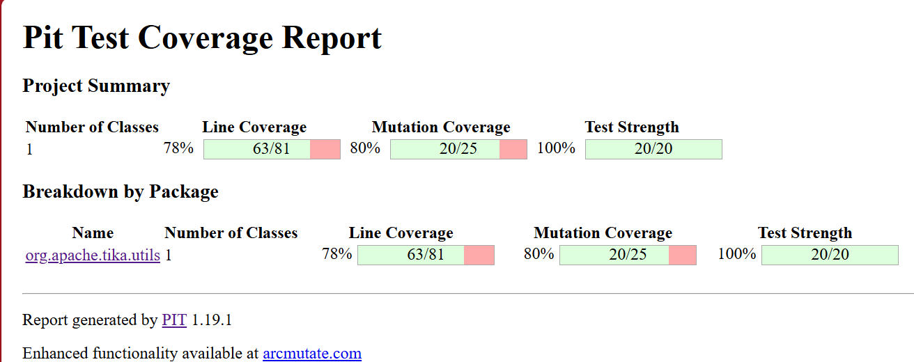
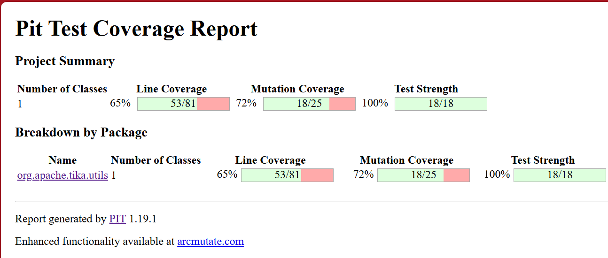

Les **tests originaux obtiennent de meilleurs résultats** que les tests générés, avec une couverture des lignes supérieure de 13 points et un score de mutation supérieur de 8 points.

L'ajout des tests ChatUniTest aux tests originaux ne produit aucune amélioration : le score reste à **80 %** , avec les mêmes cinq mutants non couverts.

Cela indique que les tests générés sont principalement redondants avec les tests existants. Les 18 mutants détectés par ChatUniTest sont également détectés par les tests originaux.

#### 3. Analyse des différences 

L'examen des rapports PIT révèle deux mutations détectées par les tests originaux, mais non couvertes par ChatUniTest.

|**Ligne**|**Méthodes**|**Mutation**|**Théorie**|
|---------|------------|------------|-----------|
|112|isSupported()|Retour `false` remplacé par `true`|Les tests originaux vérifient davantage de noms d'encodage mal formés, déclenchant `IllegalCharsetNameException`.|
|179|forName()|Valeur retournée remplacée par `null`|Les tests originaux couvrent les mécanismes de normalisation de noms tels que `win1251` et `iso-8851-1`.|

Ces différences montrent que les tests originaux explorent davantage les **cas limites et les mécanismes de correction des entrées**, tandis que les tests générés privilégient des cas plus simples.

### 4. Analyse des mutants non couverts
Les tests combinés laissent cinq mutants non couverts :

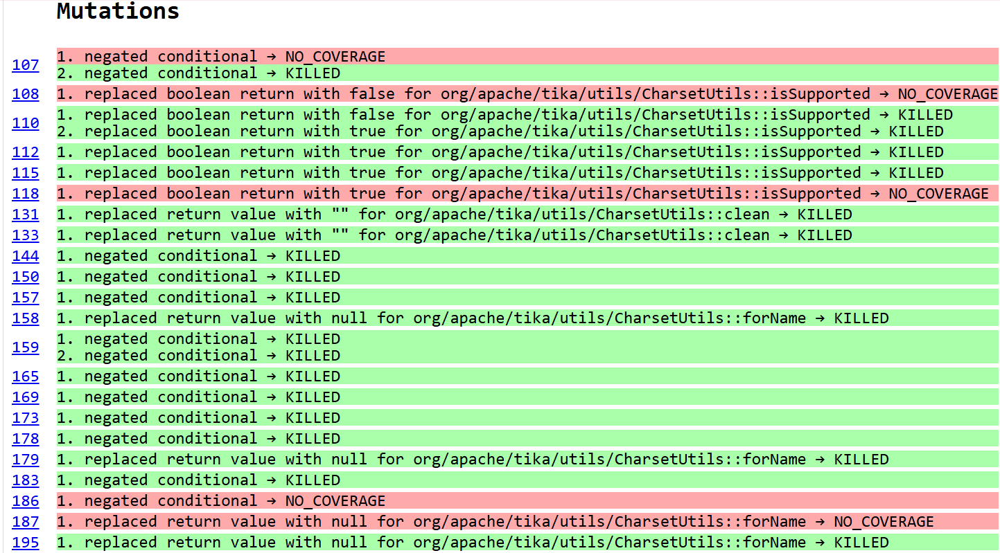

L'analyse du rapport PIT montre que **20 des 25 mutants ont été tués**, tandis que cinq restent non couverts (`NO_COVERAGE`), aux lignes **107, 108, 118, 186 et 187**.

Quatre de ces mutants (107, 108, 186 et 187) concernent des branches liées à **ICU4J**, une bibliothèque facultative de gestion des encodages. Ces branches ne sont pas exercées par les tests actuels, possiblement parce que les fonctionnalités ICU4J ne sont pas activées dans l'environnement de test.

Le cinquième mutant (ligne 118) concerne la gestion d'une exception inattendue dans `isSupported()`, un scénario qui n'est pas déclenché par les entrées testées.

**Aucun mutant couvert n'a survécu** (*Test Strength* de 100 %). Les limites observées concernent donc principalement des chemins d'exécution non couverts, plutôt que des assertions insuffisantes.

Ces cinq mutants constituent les cibles de la prochaine étape : la conception de tests manuels visant à améliorer la couverture et le score de mutation.

### Tests manuels et résultats finaux

Après l'analyse des mutants non couverts, nous avons développé des tests manuels ciblant les branches non exécutées de `CharsetUtils`.

Un premier test provoque une exception lors de l'invocation réflexive dans `isSupported()` et vérifie que la méthode retourne `false`. Les autres tests simulent un fournisseur ICU4J pour vérifier la reconnaissance d'un encodage et la récupération d'un objet `Charset` par `forName()`.

Ces tests utilisent la réflexion Java pour simuler les comportements attendus des méthodes ICU4J, dont la classe recherchée n'était pas disponible dans notre environnement. Les oracles vérifient les valeurs retournées par les méthodes testées.

**Résultat :** les cinq mutants initialement non couverts (lignes 107, 108, 118, 186 et 187) ont été tués. Le score de mutation est passé de **80 % (20/25) à 100 % (25/25)** et la couverture des lignes de **78 % à 85 %**.

Ces résultats montrent que les tests manuels ont complété les tests existants et générés en ciblant précisément les chemins d'exécution non couverts.

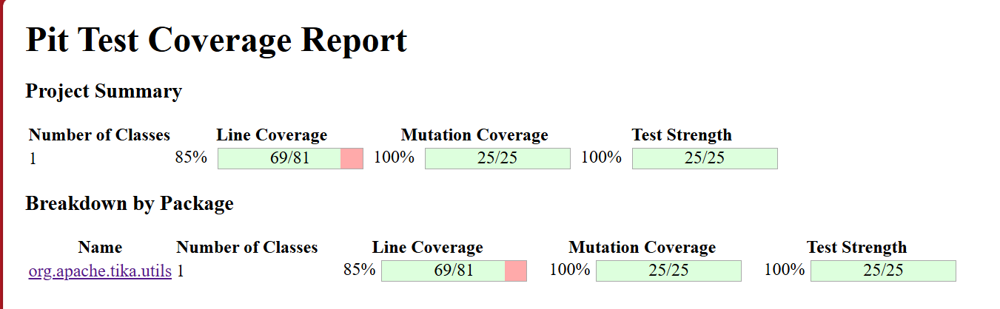

## ConcurrentUtils — Cyreanne  (MacOS)

### Usage IA
En plus de ChatUniTest et de CodeQwen exigés par l'énoncé, j'ai utilisé l'assistant Claude Anthropic, comme aide ponctuelle sur les parties avec lesquelles j'ai eu des difficultés : erreurs de Maven et de configuration, échec de compilation des tests générés, interprétation de PIT etc...

Environnement : MacOS, Java 21, Maven 3.9.9, Ollama avec `codeqwen:v1.5-chat`, PIT 1.25.9

### Pourquoi cette classe

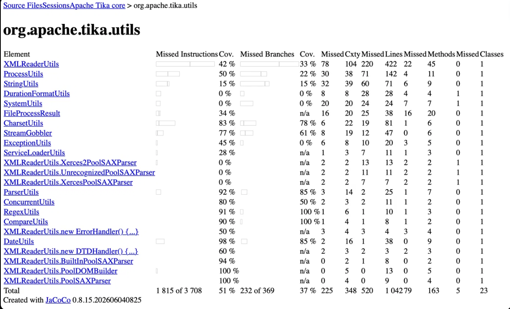

`ConcurrentUtils.execute(ParseContext, Runnable)` a deux chemins : si aucun `ExecutorService` n'est présent dans le `ParseContext`, la tâche est lancée dans un nouveau thread, sinon elle est soumise à l'exécuteur (`executorService.submit(runnable)`)

La classe possède déjà 2 tests mais le 2ème chemin n'est jamais exécuté. Le test `testExecuteExecutor` est censé tester le deuxième chemin mais il enregistre l'exécuteur sous la clé `SimpleThreadPoolExecutor.class`. La Couverture initiale JaCoCo, indiquait 80 % des instructions et 50 % des branches couvertes

### ChatUniTest

#### Commande 
mvn -pl tika-core test-compile chatunitest:class -DselectClass=ConcurrentUtils

#### Configuration
J'ai lancé ChatUniTest avec la configuration faite par mon binôme (5 tests demandés et jusqu'à 5 tentatives par test). Durée de génération : environ 27 minutes et aucun n'a compilé (un total de 25 tests).

Messages d'erreurs : `package org.mockito does not exist` et `package org.mockito.junit.jupiter does not exist`

#### Problèmes rencontrés
ChatUniTest ajoute automatiquement des imports Mockito à chaque test généré, alors que Mockito n'était pas une dépendance de tika-core. Sur les 50 tentatives réalisées pour ConcurrentUtils et RegexUtils, 49 ont échoué uniquement à cause de Mockito

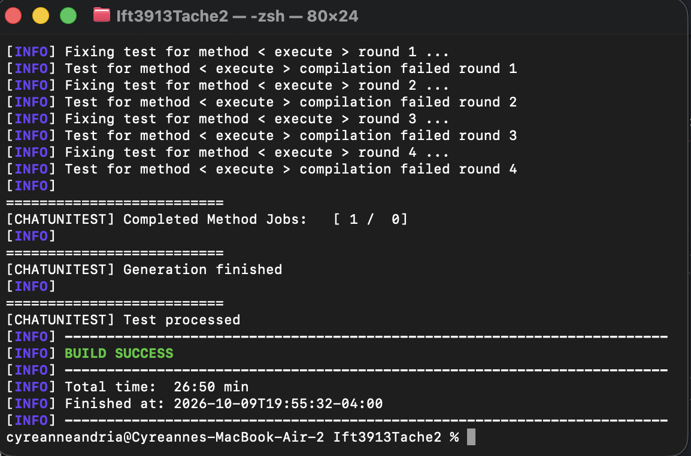

Pour regler le problème j'ai ajouté Mockito comme dépendance de test dans le pom.xml de tika-core (mockito-core et mockito-junit-jupiter). et après cet ajout le test `ConcurrentUtils_execute_0_2_Test` a compilé correctement mais ses 2 tests échouaient.

Test brut : `tika-core/chatunitest-tests/org/apache/tika/utils/ConcurrentUtils_execute_0_2_Test.java`

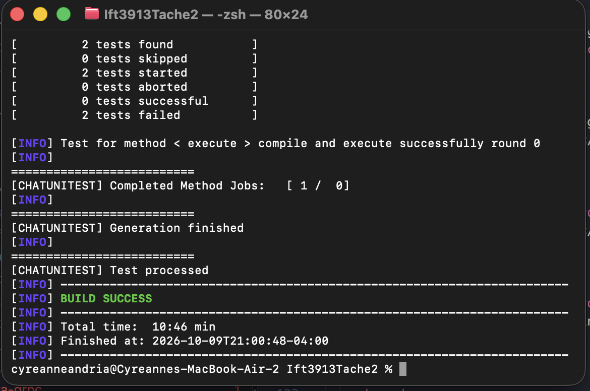

#### Corrections manuelles
1. Le résultat était comparé à un mock `FutureTask` jamais utilisé par `execute()` : remplacé par une vérification du type renvoyé.
2. L'IA vérifiait que le thread du test s'appelle "Tika Thread" : remplacé par une vérification que la tâche se termine et que le `Runnable` est exécuté.
3. Le mock `ExecutorService` n'était pas programmé (`submit()` renvoyait `null`) : ajout du `Future` à renvoyer.

S'y ajoutent l'en-tête de licence et le nettoyage des imports. Après correction : `Tests run: 2, Failures: 0 BUILD SUCCESS`

### Oracles
Les oracles des tests originaux sont faibles. Ils vérifient seulement que la tâche se termine. C'est pour cette raison que le test original passe sans passer l'exécuteur.

ChatUniTest  quant à lui, vérifie quel objet est renvoyé par `execute()` et cela permet de distinguer réellement les deux chemins.

Une fois les petites erreurs corrigées, l'oracle du second test `(assertEquals(future, result))` est précis et échoue dès que la tâche n'est pas confiée à l'exécuteur.

ChatUniTest a proposé ici une idée d'oracle meilleure que celle des tests originaux, mais son exécutiom contenait des erreurs qui ont dû être corrigées à partir du code source.

### PIT

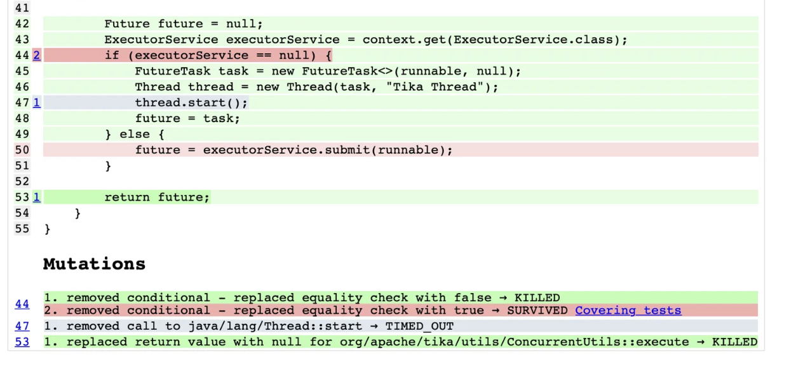

PIT a été ajouté au pom.xml de tika-core (plugin pitest-maven 1.25.9 avec le support JUnit 5). prenant en compte uniquement les classes ConcurrentUtils et RegexUtils et leurs classes de test :
`mvn -pl tika-core test-compile org.pitest:pitest-maven:mutationCoverage`

Avec les mutateurs par défaut, les tests originaux tuaient 7 mutants sur 7 pour les classes ConcurrentUtils et RegexUtils, alors que la ligne 50 de ConcurrentUtils n'était jamais exécutée. Les mutateurs par défaut produisent en effet surtout des mutants qui font planter le programme, et donc faciles à détecter. Le groupe de mutateurs STRONGER alors a été utilisé et ajoute des mutants forçant une condition à toujours prendre le même chemin.

Trois configurations :
`Tests originaux : ConcurrentUtilsTest`
`Tests originaux + ChatUniTest : avec ConcurrentUtils_execute_0_2_Test`
`Tous les tests : avec, en plus, ConcurrentUtilsManualTest`

|**Indicateur**|**Tests originaux**|**+ ChatUniTest**|**+ Tests manuels**|
|--------------|-------------------|-----------------|-------------------|
|Couverture des lignes|82 % (9/11)|91 % (10/11)|91 % (10/11)|
|Mutants générés|4|4|4|
|Mutants tués|3|4|4|
|Mutants survivants|1|0|0|
|**Score de mutation**|75 %|100 %|100 %|


#### Analyse des mutants
|**Ligne**|**Mutation**|**Avant**|**Après**|**Explication**|
|---------|------------|---------|---------|---------------|
|44|Toujours utiliser l'exécuteur|Tué|Tué|`submit()` est appelé sur `null` : `NullPointerException`.|
|44|Toujours créer un thread|**Survivant**|**Tué**|Le test ChatUniTest corrigé attend le `Future` de l'exécuteur et reçoit un autre objet.|
|47|`thread.start()` supprimé|Tué (délai)|Tué (délai)|La tâche ne démarre jamais et `result.get()` attend indéfiniment.|
|53|Valeur retournée remplacée par `null`|Tué|Tué|`result.get()` sur `null` provoque une erreur.|

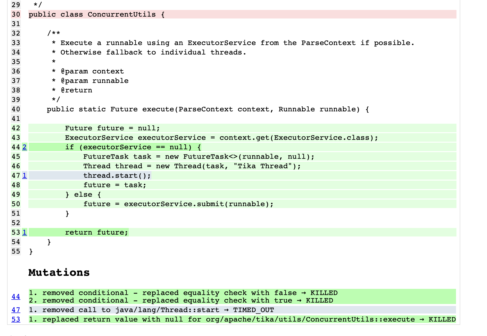

### Tests manuels
Fichier : ConcurrentUtilsManualTest.java. 
Deux tests sans mock : la tâche enregistre le nom de son thread, qui sert d'oracle.

`testExecuteWithNullExecutorService` sans exécuteur et la tâche tourne dans un thread créé par execute(). Il contient un ParseContext vide. Oracle : le thread s'appelle "Tika Thread" c'est un nom donné par execute().

`testExecuteWithNonNullExecutorService` avec un exécuteur et la tâche lui est réellement confiée. Il contient un vrai `SimpleThreadPoolExecutor`qui est enregistré sous la bonne clé `ExecutorService.class`. Oracle : le thread s'appelle "Tika Executor Thread" et c'est le nom donné par cet exécuteur. Ce test tue le mutant « toujours créer un thread ».

Validation : Tests run: 2, Failures: 0. BUILD SUCCESS

## RegexUtils — Cyreanne  (MacOS)
Test brut : `tika-core/chatunitest-tests/org/apache/tika/utils/RegexUtils_extractLinks_0_0_Test.java`

### Pourquoi cette classe
`RegexUtils.extractLinks(String)` renvoie les URL trouvées dans un texte grâce à une expression régulière.
La seule ligne non couverte de la classe est son constructeur implicite selon Jacoco, ce qui veut dire 100 % des branches couvertes. Cette couverture est cependant trompeuse, les tests originaux ne vérifient l'expression régulière qu'avec des URL simples, et ni JaCoCo ni PIT ne peuvent évaluer une expression régulière. De plus, un mutant survit avec STRONGER.

### ChatUniTest

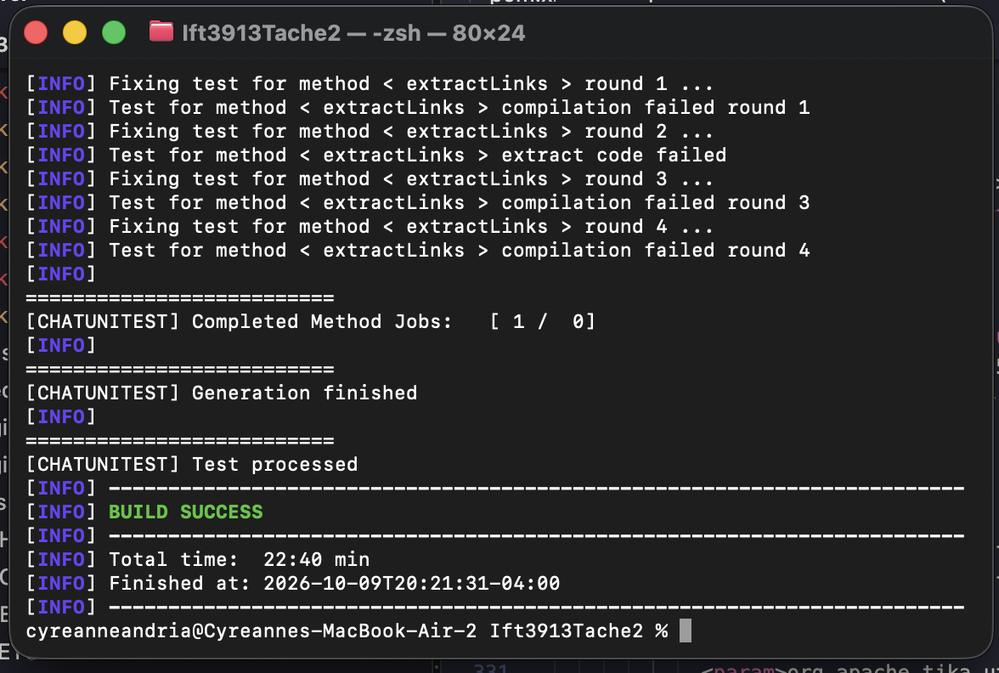

`mvn -pl tika-core test-compile chatunitest:class -DselectClass=RegexUtils`

Comme avec ConcurrentUtils, la première génération donne un resultat de 25 tentatives avec aucune ayant compilée (même cause c'est le Mockito aussi). Après l'ajout de Mockito : `RegexUtils_extractLinks_0_0_Test` compile et réussit dès le debut.


Il n'y a pas eu de correction manuelle à faire de ce côté, juste l'ajout de l'en-tête de Licence ainsi que quelques imports.

### Oracles
2 oracles sur 3 sont redondants (null, chaîne vide) avec les tests originaux. Il n'y a que le schéma https qui est nouveau.
Les oracles sont précis et ont permis de faire la comparaison de la liste complète (contenu, nombre et ordre).
L'IA s'attarde quand même uniquement sur les évidents et n'explore pas l'expression régulière (fragments, encodage et ponctuation).

### PIT
|**Indicateur**|**Tests originaux**|**+ ChatUniTest**|**+ Tests manuels**|
|--------------|-------------------|-----------------|-------------------|
|Couverture des lignes|90 % (9/10)|90 % (9/10)|90 % (9/10)|
|Mutants générés|7|7|7|
|Mutants tués|6|6|6|
|Mutants survivants|1|1|1|
|**Score de mutation**|86 %|86 %|86 %|

Les 6 mutants tués le sont dès les tests originaux (liste toujours vide, boucle jamais exécutée, NullPointerException sur null, etc.).
Cependant, il y a un mutant survivant et il supprime la vérification `content.isEmpty()`. Sans ça une chaîne vide passe dans l'expression régulière, qui ne trouve rien, et la méthode renvoie quand même une liste vide. Ce mutant est équivalent, ce qui veut dire que le comportement est identique, donc aucun test ne peut le tuer. : 86 % est le maximum que l'on peut atteindre.

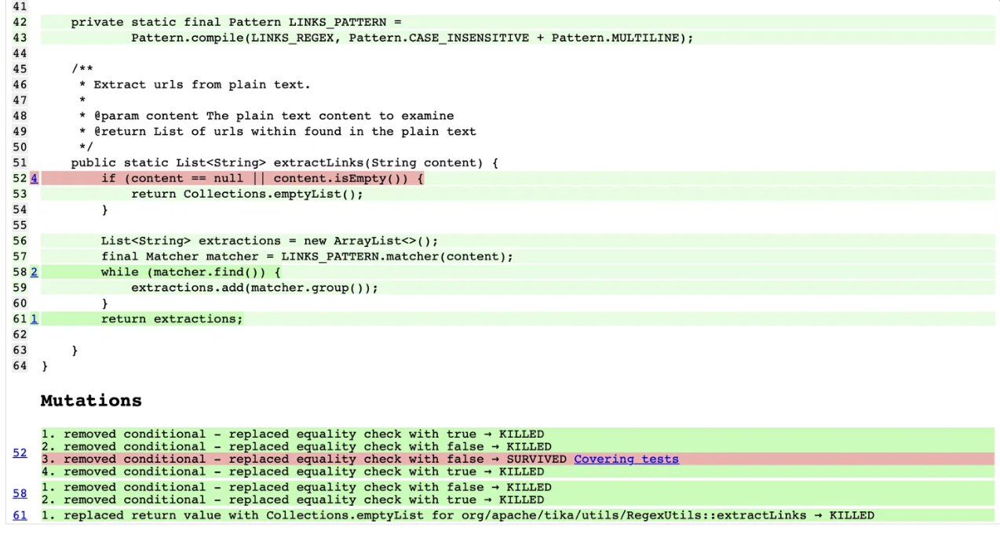

### Tests manuels
Fichier : `RegexUtilsManualTest.java`. Ces tests visent l'expression régulière, que PIT ne peut pas évaluer.

|**Test**|**Données**|**Oracle**|
|--------|-----------|----------|
|`testExtractLinksGardeRequeteEncodageEtFragment`|`https://tika.apache.org/docs/a%20b?x=1&y=2#section-3`|URL entière : `?`, `&`, `%20` et `#` sont acceptés.|
|`testExtractLinksArreteUrlSurUnEncodageInvalide`|`http://exemple.com/%zz`|`http://exemple.com/` : `%` doit être suivi de 2 chiffres hexadécimaux.|
|`testExtractLinksMajusculesEtPlusieursLignes`|`HTTP://A.EXEMPLE.COM` et une URL `ftp` sur 2 lignes|Les 2 URL, séparées, dans l'ordre.|
|`testExtractLinksGardeLePointFinal`|« Voir http://exemple.com. »|`http://exemple.com.` **avec le point** : limite de Tika.|
|`testExtractLinksAccepteToutSchema`|`mailto:...` et « Attention:danger »|Les 2 sont extraits : faux positif.|

Les deux derniers révèlent des défauts qu'aucun outil (JaCoCo, PIT, ChatUniTest) n'avait détectés. Validation : `Tests run: 5, Failures: 0  BUILD SUCCESS`.

## Comparaison et conclusion

### ConcurrentUtils et RegexUtils
|**Classe**|**Tests ChatUniTest utilisables sans correction**|**Corrections fonctionnelles**|**Score de mutation avant**|**Score de mutation après**|
|----------|------------------------------------------------|------------------------------|---------------------------|---------------------------|
|ConcurrentUtils|Non|3|75 %|100 %|
|RegexUtils|Oui, après ajout de Mockito|0|86 %|86 %|

Pour ces deux classes, ChatUniTest n'a produit aucun test compilable lors de la première génération, à cause des imports Mockito ajoutés automatiquement. Après l'ajout de Mockito comme dépendance de test, les deux tests générés ont compilé dès le premier essai.

Pour ConcurrentUtils, l'IA a proposé une meilleure idée d'oracle que les tests originaux, mais trois corrections ont été nécessaires. Une fois corrigé, son test a permis de tester le chemin de l'exécuteur, jamais exécuté auparavant, et de faire passer le score de mutation de 75 % à 100 %.

Pour RegexUtils, les tests générés étaient corrects mais redondants avec les tests originaux, et n'ont tué aucun mutant supplémentaire. Le seul mutant restant est équivalent : 86 % est le maximum atteignable.
RegexUtils montre aussi les limites des métriques : la classe était couverte à 100 % des branches, mais nos tests manuels ont révélé des défauts de l'expression régulière qu'aucun outil n'avait détectés.

En conclusion, ChatUniTest est un point de départ utile, mais ses tests doivent être vérifiés, corrigés et complétés par des tests conçus manuellement.

### CharsetUtils

Pour CharsetUtils, les tests générés par ChatUniTest n'étaient pas directement utilisables. Plusieurs corrections ont été nécessaires, notamment la suppression d'imports Mockito inutilisables, la correction d'appels par réflexion et l'ajustement d'oracles incorrects concernant les noms d'encodages et les exceptions attendues.

Les tests générés ont obtenu un score de mutation de **72 %**, contre **80 % pour les tests originaux**. Leur combinaison n'a apporté aucune amélioration : les 20 mutants tués par les tests combinés étaient déjà détectés par les tests originaux. Cela montre que les tests générés étaient principalement redondants et n'exerçaient pas de nouveaux chemins d'exécution.

L'analyse PIT a permis d'identifier cinq mutants non couverts, principalement associés aux fonctionnalités facultatives ICU4J et à la gestion des exceptions. Nous avons alors conçu des tests manuels ciblés, utilisant la réflexion Java pour simuler les comportements du fournisseur ICU4J et provoquer une exception inattendue. Ces tests ont permis de tuer les cinq mutants restants.

Le **score de mutation est ainsi passé de 80 % à 100 % (25/25 mutants tués)**, tandis que la couverture des lignes est passée de **78 % à 85 %**. Ces résultats illustrent l'intérêt de l'analyse de mutation pour orienter la conception de tests manuels vers des scénarios précis que les tests générés n'avaient pas explorés.


--------------------------------------------------------------------------------------------------------------------
En conclusion, l'expérience sur les trois classes montre que l'efficacité de ChatUniTest varie selon le code testé. La génération automatique peut proposer des scénarios intéressants, mais elle ne garantit ni la validité des oracles ni une amélioration de la couverture des mutations. **La vérification humaine, l'analyse PIT et la conception de tests manuels ciblés restent essentielles pour améliorer la qualité des tests.**


## Exécution dans la GitHub Action

Le fichier `.github/workflows/tache2.yml` lance, à chaque push, les 17 tests de ConcurrentUtils et RegexUtils, puis PIT. L'exécution réussit.

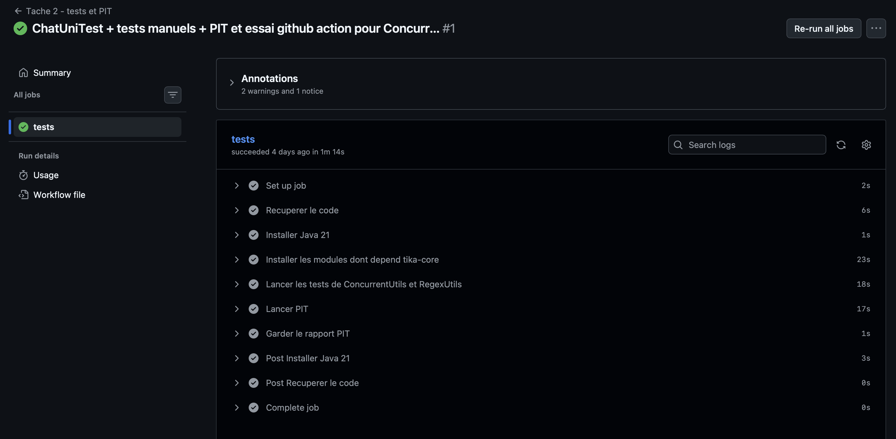
