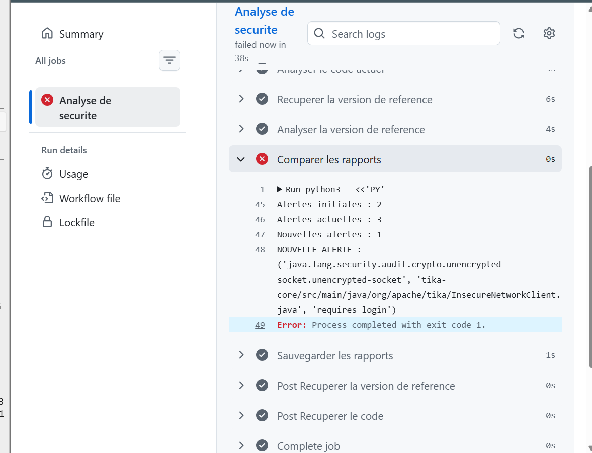
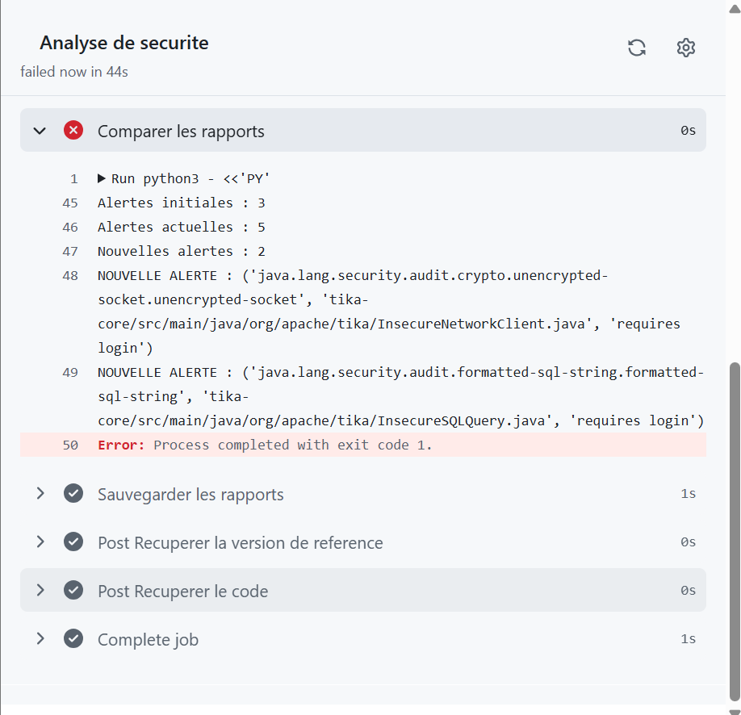
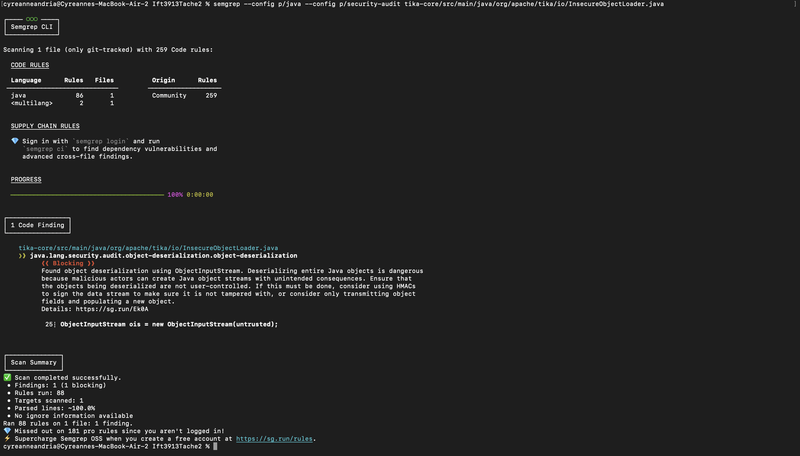
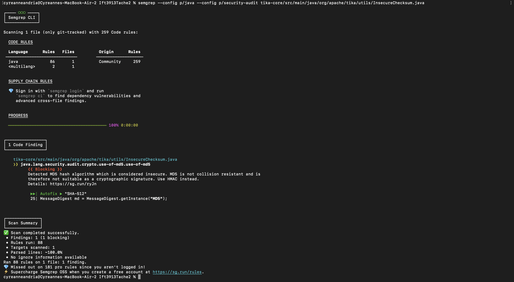
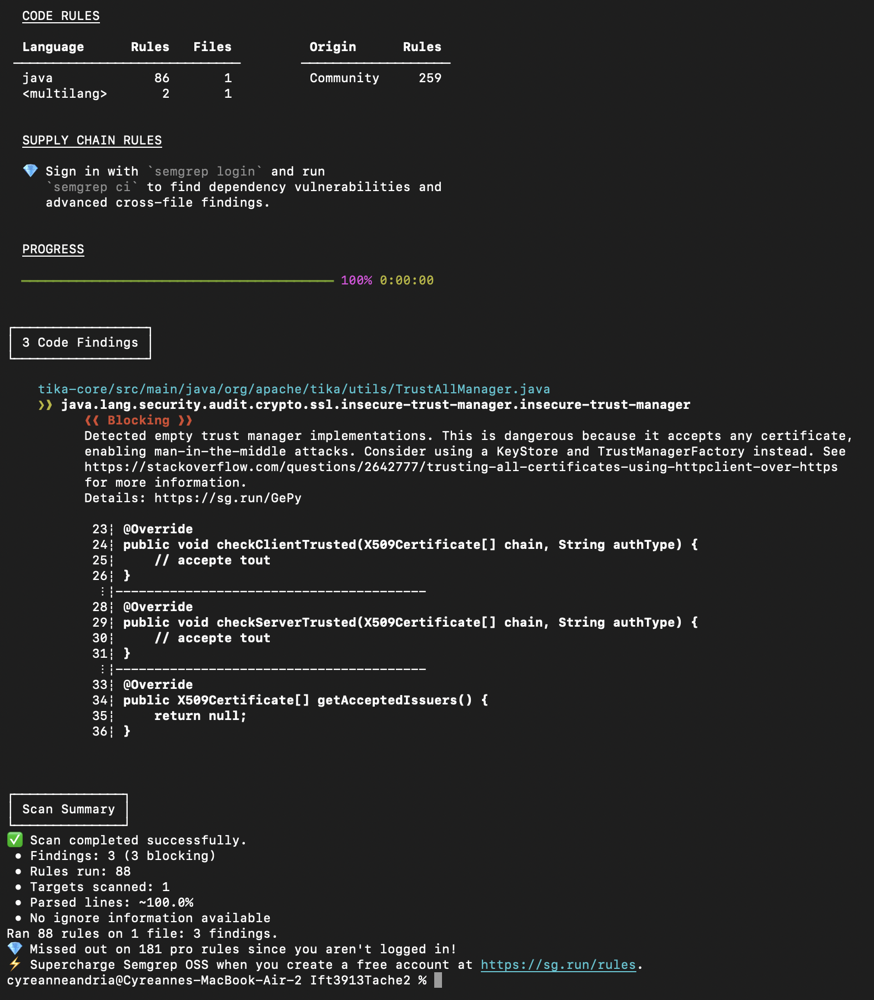
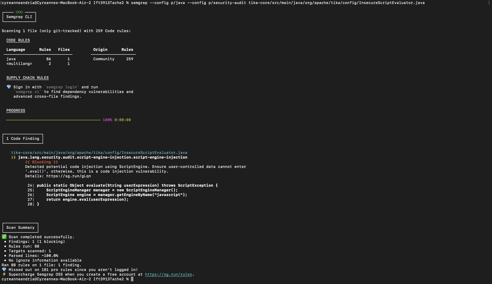
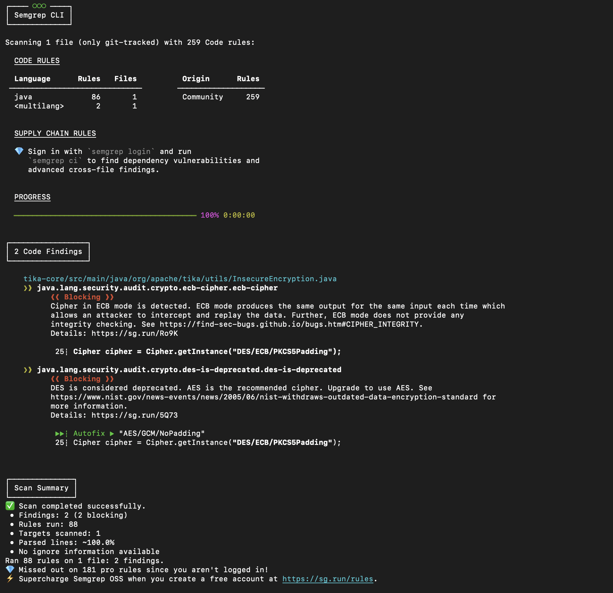

# IFT3913 — Tâche 3

**Équipe :** Océane Molly-Fleur Ndong et Cyreanne Candy Andrianefa

## 1. Notre workflow Semgrep

Pour cette tâche, on devait faire en sorte que GitHub Actions échoue lorsqu'on introduit une nouvelle vulnérabilité dans Tika.
On a donc ajouté un workflow qui lance Semgrep sur notre code et sur une version de référence du projet. Ensuite, un petit script Python compare les deux rapports pour voir si de nouvelles alertes sont apparues.
On a utilisé `p/security-audit` et `p/java` pour les règles Semgrep.
Ce qu'on voulait surtout éviter, c'était que le workflow échoue à cause des vulnérabilités qui existaient déjà dans Tika. C'est pour ça qu'on a préféré comparer les résultats plutôt que de simplement faire échouer le build dès que Semgrep trouve quelque chose.

### Nos premiers tests

On a commencé par lancer le workflow sans ajouter de vulnérabilité. Il passait correctement.
Ensuite, on a ajouté temporairement un socket non chiffré pour voir si GitHub Actions allait réagir. Semgrep a trouvé une nouvelle alerte et le workflow a échoué. On a ensuite retiré ce premier code de test.
Ça nous a permis de vérifier que notre comparaison fonctionnait dans les deux situations.

## 2. Les vulnérabilités qu'on a ajoutées

### 1. Socket non chiffré — `InsecureNetworkClient.java`

<!-- CAPTURE GITHUB ACTIONS — VULNÉRABILITÉ 1 : remplacer le chemin ci-dessous par celui de votre capture dans le dépôt. -->

Pour notre première vulnérabilité, on a créé une classe dans `tika-core` qui ouvre une connexion avec `new Socket(host, port)`.
On a choisi cet exemple parce qu'on avait remarqué que Semgrep signalait déjà ce type de problème dans `NetworkParser.java`. On savait donc qu'on pouvait le reproduire et vérifier sa détection.
Le problème est que la connexion n'utilise pas TLS, donc les données échangées peuvent être interceptées.

**Résultat :** Semgrep a détecté notre nouvelle vulnérabilité et le workflow a échoué comme prévu.

### 2. Injection SQL — `InsecureSQLQuery.java`

<!-- CAPTURE GITHUB ACTIONS — VULNÉRABILITÉ 2 : remplacer le chemin ci-dessous par celui de votre capture dans le dépôt. -->

Pour celle-ci, on a un peu plus galéré.
Au départ, on avait essayé de créer une injection de commande avec `ProcessBuilder`. Le code était vulnérable, mais Semgrep ne signalait rien avec nos règles. On a même essayé d'ajouter `p/java`, sans obtenir la détection qu'on cherchait.
Plutôt que de continuer à modifier les règles, on a finalement choisi une injection SQL.
On a créé une méthode qui construit une requête SQL en ajoutant directement une entrée utilisateur dans la chaîne. Sans requête préparée, cette entrée pourrait modifier la requête exécutée.

**Résultat :** cette fois, Semgrep a détecté la vulnérabilité avec la règle `formatted-sql-string`.

### 3. Désérialisation non sûre — `InsecureObjectLoader.java`

On a placé cette classe dans le package `org.apache.tika.io` de `tika-core`, parce que c'est là que Tika gère la lecture des flux de données. C'est donc un endroit crédible pour une méthode qui charge des objets depuis un flux. La méthode crée un `ObjectInputStream` sur un flux qui peut venir de l'extérieur et appelle directement `readObject()`, sans aucun filtre sur les classes acceptées (CWE-502). Un attaquant pourrait donc envoyer un objet sérialisé malveillant qui exécute du code au moment de la désérialisation.

**Résultat :** Semgrep a détecté la vulnérabilité avec la règle `object-deserialization`, sur la ligne qui crée l'`ObjectInputStream`.

### 4. Hachage faible — `InsecureChecksum.java`

Cette classe est dans `org.apache.tika.utils`, avec les autres utilitaires de Tika. Elle calcule une empreinte avec l'algorithme MD5 (CWE-328). MD5 n'est plus considéré comme sûr : on peut fabriquer deux contenus différents qui donnent la même empreinte. Si cette empreinte servait à vérifier l'intégrité d'un document, un attaquant pourrait donc le remplacer sans que ça se voie. On a choisi MD5 plutôt que SHA-1, qui était déjà signalé dans Tika avant nos modifications, pour que la nouvelle alerte soit bien distincte.

**Résultat :** Semgrep a détecté la vulnérabilité avec la règle `use-of-md5`. Il propose même une correction automatique : remplacer MD5 par SHA-512.

### 5. Certificats non vérifiés — `TrustAllManager.java`

On a implémenté un `X509TrustManager` dont les deux méthodes de vérification (`checkClientTrusted` et `checkServerTrusted`) sont vides, et dont `getAcceptedIssuers()` renvoie `null`. Ce gestionnaire accepte donc n'importe quel certificat, même faux ou expiré (CWE-295). Une connexion HTTPS qui l'utiliserait n'aurait plus aucune protection contre une attaque de l'homme du milieu. On l'a mis dans `org.apache.tika.utils`, puisque c'est typiquement le genre d'utilitaire qu'on ajoute « pour faire marcher » une connexion vers un serveur qui a un certificat invalide.

**Résultat :** Semgrep a détecté la vulnérabilité avec la règle `insecure-trust-manager`, qui s'est déclenchée trois fois, une fois sur chacune des méthodes de la classe.

### 6. Injection de script — `InsecureScriptEvaluator.java`

Cette classe est dans `org.apache.tika.config`, parce qu'on peut imaginer une configuration qui contient des expressions à évaluer. La méthode reçoit une chaîne venant de l'extérieur et la passe directement à `ScriptEngine.eval()`, qui l'exécute comme du code (CWE-94). Un attaquant qui contrôle cette chaîne pourrait donc faire exécuter son propre code par l'application.

**Résultat :** Semgrep a détecté la vulnérabilité avec la règle `script-engine-injection`.

### 7. Chiffrement faible — `InsecureEncryption.java`

Cette classe, dans `org.apache.tika.utils`, chiffre des données avec `Cipher.getInstance("DES/ECB/PKCS5Padding")` (CWE-327). Elle cumule deux problèmes. D'abord, l'algorithme DES utilise une clé de 56 bits, qu'on peut retrouver par force brute en peu de temps. Ensuite, le mode ECB chiffre deux blocs identiques de la même façon, ce qui laisse voir des motifs dans les données chiffrées.

**Résultat :** Semgrep a détecté la vulnérabilité avec deux règles sur la même ligne : `des-is-deprecated` pour l'algorithme DES, et `ecb-cipher` pour le mode ECB. Il propose aussi de remplacer par `AES/GCM/NoPadding`.

### Le Rickroll… devenu Meowroll 🐈

Pour la partie humour, on voulait faire quelque chose d'un peu différent du rickroll classique de Rick Astley lol (parce qu'on s'est dit que le prof allait sûrement en voir 50 😭).

On est donc tombées sur une version avec un chat et on a décidé de partir sur un **MEOWROLL.EXE**, avec quelques jeux de mots de dev, notamment notre préféré : *« No rollback. Only meowback. »*

Côté technique, on a créé une action réutilisable qui se déclenche quand les tests échouent. Pour vérifier, on a temporairement ajouté `exit 1` dans le workflow. Résultat : l'étape des tests passe au rouge et notre action apparaît bien dans les logs. On a ensuite retiré le `exit 1` pour remettre les choses en ordre.

Bref, j'espere vous aimez les chats !
